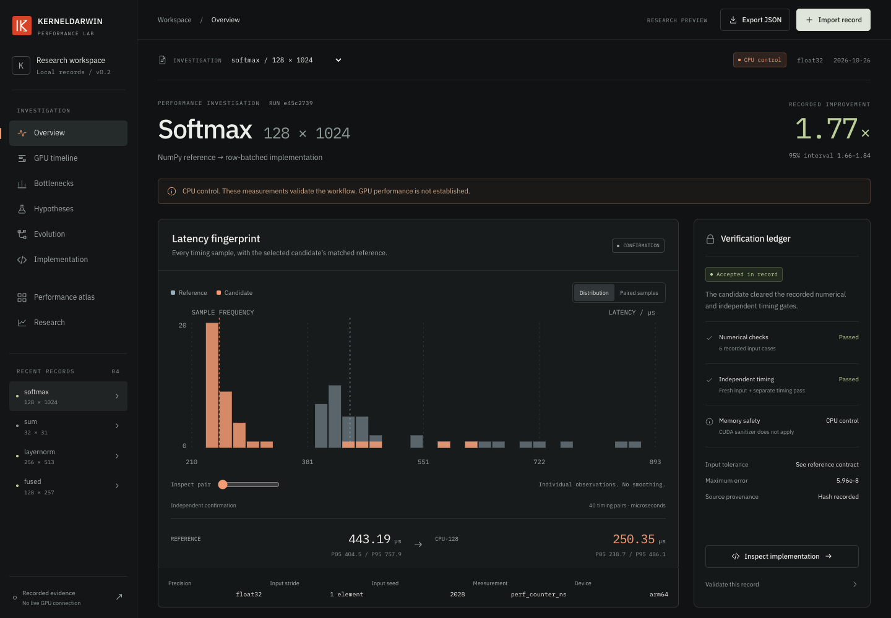
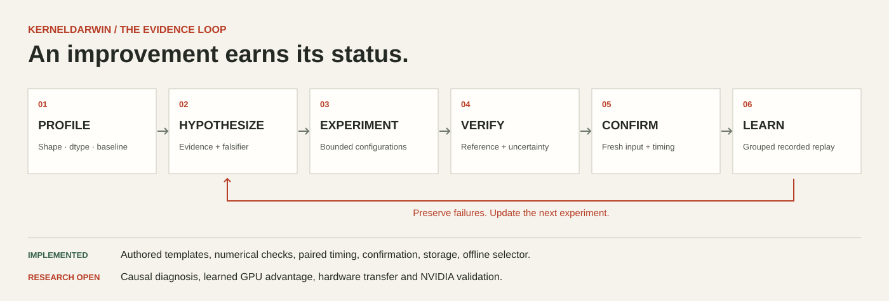

<p align="left"></p>

# KERNELDARWIN

### Why is this GPU program slow? Keep the experiment that answers it.

An evidence-first performance investigation laboratory. Profile a bounded workload, keep competing explanations, test targeted Triton configurations, and preserve the numerical checks and timing uncertainty behind each decision.

**v0.2.0 is a research preview.** The development host is an Apple M4, with no NVIDIA CUDA device. The release includes actual CPU control experiments, a fitted CPU intervention selector, and a prepared CUDA/Triton execution path. **No GPU speedup, GPU-trained policy, causal GPU diagnosis, sanitizer pass, or GPU superiority is claimed.** [Validation status →](docs/validation.md)

[Explore the LAB](https://nazeeh111.github.io/KERNELDARWIN/) · [Quickstart](#try-the-laboratory) · [Research](docs/research.md) · [Methodology](docs/methodology.md) · [Releases](https://github.com/nazeeh111/KERNELDARWIN/releases)



## One investigation, all the evidence

The shipped controls compare a higher-precision NumPy reference with batched float32-intermediate implementations within declared tolerances. They exercise the same record, correctness, paired timing, confirmation and learning components used by the CUDA path. They are **CPU software controls**, not evidence of GPU optimization.

The reproducible suite contains **24 workloads, 72 attempted interventions, four operation families and six shapes**, including strided inputs and no-improvement cases. Raw measurements, failed decisions, source identities and a trained model live in [the evidence directory](evidence/cpu-2026-10-26/). [Read the measured result and its limits](docs/results.md).

The LAB now places the measured latency fingerprint and verification ledger together, with a keyboard-accessible timing-pair inspector, parent-aware candidate history, and synchronized evidence selection. Its self-hosted IBM Plex typography and interruptible, reduced-motion-aware transitions serve the investigation.

The LAB lets you follow the useful questions: what was measured, which explanation remains plausible, what changed, and what passed independent confirmation? GPU timelines, utilization and rooflines stay unavailable when their required measurements are absent.

<p><a href="docs/assets/v0.2/workbench.mp4"></a></p>

[Watch the current workbench recording](docs/assets/v0.2/workbench.mp4). The [original v0.1 demo](docs/demo/brag.mp4) is preserved. The current v0.2 workbench has a redesigned interface with paired-sample inspection, linked candidate selection, accessible lineage, and source comparison. CPU control playback remains labeled; it is not live GPU optimization.

## Try the laboratory

Python 3.11 or later. Basic installation has no runtime dependencies or model-provider credentials.

```bash
git clone https://github.com/nazeeh111/KERNELDARWIN.git
cd KERNELDARWIN
python -m pip install .
kd doctor
kd lab
# Open http://127.0.0.1:8765
```

The public LAB is static and reads recorded JSON. It never compiles or executes uploaded code. Import a record or inspect the bundled controls. No public GPU execution service is exposed.

For actual local CPU controls:

```bash
python -m pip install '.[control]'
kd control --family softmax --shape 128 1024 --store .runs
kd train --store evidence/cpu-2026-10-26/records --device-kind cpu --output .runs/cpu-model.json
python -m unittest discover -s tests -v
```

CPU models cannot be used to choose CUDA interventions. [CLI and Python API →](docs/usage.md)

## Run the CUDA path

**Requires Linux, an NVIDIA GPU with compute capability 8.0 or newer, a compatible driver, PyTorch and Triton. This path has not been executed on the release host.** Optional dependencies are version-bounded; inspect `kd doctor` and your platform's PyTorch installation requirements.

```bash
python -m pip install '.[cuda]'
kd doctor
kd investigate --family softmax --shape 128 1024 --max-candidates 6 --trace --store .runs
kd validate .runs/RECORD_ID.json
# Export only after correctness + discovery + independent confirmation pass:
kd export .runs/RECORD_ID.json --output optimized.py
```

The authored templates cover these finite-input, two-dimensional workloads:

| Family | Declared semantics | Initial configuration search |
|---|---|---|
| `sum` | Last-dimension reduction | Row block size and warp count |
| `softmax` | Stable row softmax | Row block size and warp count |
| `layernorm` | Row normalization, population variance, configurable epsilon, no affine parameters | Row block size and warp count |
| `fused` | `relu(float32(x) * 1.5 + 0.25)`, cast to input dtype | Element tile size and warp count |

Supported dtypes: float32, float16, bfloat16. Positive strides, nonempty shapes, at most 8,192 columns. No autograd/backward contract, arbitrary CUDA source, matmul optimizer or whole-model replacement is claimed. These are inference adapters. The exported callable enforces the verified shape, dtype, strides, device and source identity.

GPU timing uses warmup, synchronization, randomized paired baseline/candidate ordering, and repeated CUDA events. Compilation/first dispatch is reported separately. Promotion requires reference correctness, a bootstrap lower speedup bound above 1.03, then a fresh-input confirmation. `torch.compile` is measured separately when available. Memory safety remains unverified until independently checked with the supported [sanitizer procedure](docs/usage.md#memory-safety-and-profiling). A constrained subprocess runs only finite authored templates, with a timeout and an environment allowlist; it is not a hostile-code sandbox.

[An attention application benchmark](examples/attention.py) integrates an exported softmax into `QKᵀ → softmax → V` and compares eager, compiled and optimized application paths. It requires a real accepted CUDA export. **No application-level GPU result has been collected.**

## From hypothesis to intervention



The current selector is a compact contextual ridge model with an uncertainty bonus. It learns from recorded rewards, failure outcomes and experiment costs. Offline evaluation holds out whole families and shapes, compares random selection, fixed rules and sequential Gaussian-process Bayesian selection, and ablates workload context and uncertainty. CPU replay results do not establish the GPU research question. Standard Triton autotuning and existing agent baselines still require an actual matched CUDA study.

Hypotheses preserve evidence, missing measurements and falsifiers. The preview does not update them into proven causes merely because one candidate is faster. Diagnosis-conditioned learning, profiler-feature ablations and hardware holdouts remain research work. [Prior art and licensing →](docs/prior-art.md)

## Build on it

- [Install, CLI/API, export and troubleshooting](docs/usage.md)
- [Benchmark credibility and semantic contracts](docs/methodology.md)
- [Research question, comparisons and limits](docs/research.md)
- [Selector features, training and evaluation](docs/selector.md)
- [Architecture](docs/architecture.md) and [contributing](CONTRIBUTING.md)
- [License and attribution](THIRD_PARTY_NOTICES.md), [citation](CITATION.cff), [release notes](CHANGELOG.md)

CPU CI validates contracts and distributions. GPU validation is a manual workflow requiring an explicitly provisioned trusted self-hosted runner; this project supplies no paid compute. Open an issue with a reproducible record, workload specification and environment when reporting a problem. Do not include private data or credentials.

Apache-2.0 · Copyright 2026 Nazeeh Abdul-Hadi
