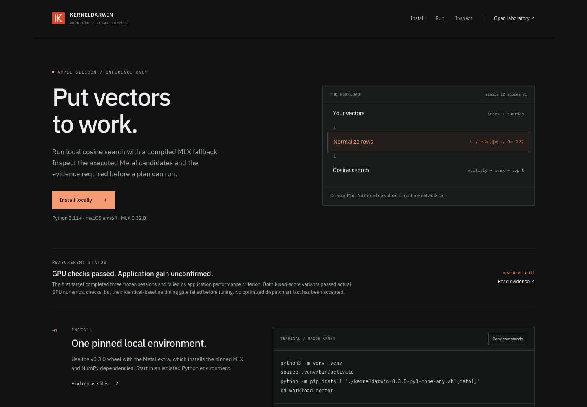

<p align="left"></p>

# KERNELDARWIN Workload

Investigate a real GPU workload, then install only what survives independent checks.

**v0.3.0 is in development.** The local cosine-search application and six authored Metal configurations have executed on an Apple M4. The first frozen optimization study failed its application performance gate. The second target, fused query normalization and scoring, passed numerical checks but failed its prospective baseline-stability gate before tuning. **No optimized artifact has been accepted and no acceleration is claimed.** [Executed results and limits](docs/workload-results.md).

[Run the workload](docs/workload.md) · [Semantic contract](docs/workload-semantics.md) · [Readable kernels](src/kerneldarwin/metal/) · [Interface and editable architecture](docs/workload-interface.md) · [Releases](https://github.com/nazeeh111/KERNELDARWIN/releases)

## Run from the current source

Use Apple Silicon macOS and Python 3.11 or later. The executed environment used Python 3.12.13, MLX and MLX Metal 0.32.0, macOS 27.2 build 26B123, and a 10-core Apple M4 GPU. The basic package remains CPU-compatible; the following extra installs the pinned Metal dependencies.

```bash
python3 -m venv .venv
source .venv/bin/activate
python -m pip install '.[metal]'
kd workload doctor
kd workload demo --query "cosine search vectors"
```

`doctor` executes a tiny GPU arithmetic check. The demo refreshes a local document index and returns actual ranked matches, artifact status, fallback counts and its dispatch decision. Without an accepted artifact, it uses the complete compiled stable MLX query. Its single-call `compute_ms` includes cold work and is not a speedup measurement.

Bring your own `float32` or `float16` vectors in an NPZ archive with `documents` and `queries` arrays:

```bash
kd workload search vectors.npz --k 5
kd lab
# Open http://127.0.0.1:8765/workload.html
```

The included corpus uses deterministic token-count features, with no downloaded weights. The application also accepts caller-provided embeddings. No LLM, runtime network access, answer cache or online tuning is needed. The static LAB displays recorded evidence; it does not offer public GPU execution.

[Complete quickstart and typed Python API](docs/workload.md).



[Recorded walkthrough](docs/assets/v0.3/final/workload-interaction.mp4) · [Actual installed CLI outputs](evidence/workload-2026-10-29/discovery/installed-cli-demo.json). The browser recording shows recorded GPU results and library fallback; it does not run GPU code in the browser.

## What was investigated

The measured application performs one index refresh and three top-k searches across a declared distribution of document sizes, feature widths and layouts. Costs include allocation, GPU dispatch, materialization and host results. The study compares eager MLX, stable compiled normalization, an equivalent optimized RMS-based implementation, complete compiled query graphs, a fixed candidate, bounded per-shape tuning and a two-kernel portfolio.

| Target | Implemented variants | Current evidence |
| --- | --- | --- |
| Stable row L2 normalization | SIMD reduction, four-row SIMD grouping, packed vector access, shared reduction | 16 numerical/guard tests passed; three frozen confirmation sessions completed; application gate failed |
| Query normalization fused with similarity scoring | One SIMD group per query/document pair; shared normalized query reused across four documents | Seven further Metal numerical/application tests passed; baseline instability stopped tuning |

The first target's development portfolio reduced weighted normalization cost by about 6% versus its best fixed candidate. That did **not** establish a complete-application benefit. In confirmation session 0, the portfolio was slower at the point estimate than the complete compiled stable library query: **0.970×**, 95% interval **[0.908, 1.038]**. Later sessions also failed the frozen improvement gate. Every session and all losses remain in [the preserved study](evidence/workload-2026-10-29/target1-normalization/).

Actual Instruments evidence records GPU compute intervals for the installed application. Hardware counters and a shader timeline were unavailable. Instrumented interval observations and compiler graphs are diagnostic evidence, not a causal explanation or a replacement for the failed application confirmation.

## Installable computation and guards

`FusedPlan().index(vectors)` supplies the current compiled-library application path. A future accepted `FusedPlan("artifact")` can route exact query/document/width tuples to at most two authored score kernels. Unknown tuples, unsupported candidate dtypes and incompatible plans use the complete compiled stable query. The original `Normalizer` and `CosineIndex` injection API remains available for the first target.

Plans are data. They bind semantic operation, loaded source bytes, application and baseline implementation, study code, MLX/runtime/compiler options and device identity. Readable Metal sources accompany a confirmed manifest. Replacing installed source invalidates stale performance decisions; a running process uses one immutable source snapshot. Inputs are never mutated, and supported noncontiguous views are indexed through their actual device strides.

Stable L2 uses a clamped norm floor of `1e-12`, float32 accumulation and safe Metal math. Native float32 subnormal flushing and inference-only scope are explicit. Numerical validity is distinct from measured performance coverage. [Full contract](docs/workload-semantics.md).

An export requires current-source GPU numerical evidence, a frozen baseline noise gate, bounded development, three independent sessions beating the optimized libraries, exercised unseen-input fallback and resource checks. The first target failed those requirements, so it has no accepted export. Manufactured unit-test plans are never performance artifacts.

## Preserved research laboratory

The [original LAB](https://nazeeh111.github.io/KERNELDARWIN/) and earlier releases retain 24 real CPU control workloads, 72 interventions, selector evaluation and the prepared CUDA/Triton path. Their recorded bytes and evidence levels remain unchanged. The CUDA path has not executed on this Apple M4 host and still requires actual NVIDIA hardware; Metal execution does not validate CUDA.


[Recorded v0.2 workbench](docs/assets/v0.2/workbench.mp4) · [Original v0.1 demo](docs/demo/brag.mp4) · [CPU results](docs/results.md) · [CUDA/legacy usage](docs/usage.md) · [Prior art and attribution](docs/prior-art.md)

## Build and review

The CPU-compatible checks validate record handling, source pins, fallback and export rejection. Metal tests require explicit local execution; skips do not count as GPU evidence.

```bash
python -m unittest discover -s tests -v
# Apple Silicon, pinned Metal environment:
MTL_DEBUG_LAYER=1 MTL_SHADER_VALIDATION=1 python scripts/validate_metal.py --output NEW_ROWS_REPORT.json
MTL_DEBUG_LAYER=1 MTL_SHADER_VALIDATION=1 python scripts/validate_fused.py --output NEW_SCORES_REPORT.json
```

Use fresh report paths. Validation instrumentation is disabled for performance measurements. Follow the bounded, immutable workflow in [the workload guide](docs/workload.md), and retain failed studies rather than retrying for a favorable result.

[Contributing](CONTRIBUTING.md) · [License and notices](THIRD_PARTY_NOTICES.md) · [Citation](CITATION.cff) · [Release notes](CHANGELOG.md)

Apache-2.0 · Copyright 2026 Nazeeh Abdul-Hadi
