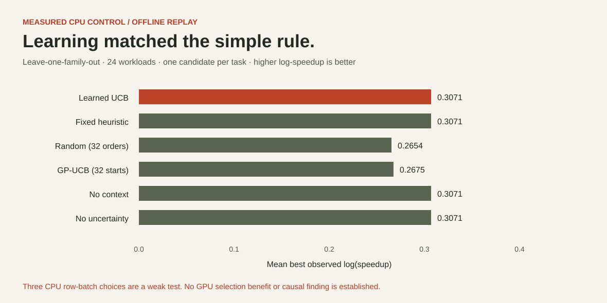

# Measured CPU controls and the null selection result

The release contains actual NumPy CPU measurements on an Apple M4 arm64 development host, using Python 3.12.14 and NumPy as recorded per run. There was no NVIDIA GPU execution. These controls validate the implementation and evidence pipeline; they do not answer the GPU research question.

The suite has 24 workloads: sum, softmax, layernorm and fused elementwise across shapes (32,31), (128,257), (128,1024), (256,513), (512,2048), (96,4095). The (256,513) cases use last-dimension stride 2. Every workload tests three actual NumPy batch sizes: 32, 128 and 512 rows. `num_warps=1` is an unused schema placeholder in CPU controls, not a GPU configuration result.

Each implementation is independently compared with a float64-intermediate reference cast to the input dtype, using the stated numerical tolerances. Candidates use float32 intermediates. This declared reference distinction is one reason the CPU timings must not be marketed as GPU improvements. After warmup, each candidate receives 40 paired, randomly ordered timings. One selected candidate receives a separate fresh-input confirmation. The suite retains 20 accepted CPU-control results and four no-improvement cases. Raw samples and all candidates are in [records](../evidence/cpu-2026-10-26/records/); accepted status concerns only these CPU semantics and measurements.

## Learned selection did not beat the heuristic

The ridge/UCB selector was genuinely fitted on 72 observed interventions. Family holdouts keep one whole operation family out of training; shape holdouts keep the whole shape group out across families. Repeated seeds for a task cannot cross a holdout boundary. The saved final model is fitted on all controls for inspection; evaluation fits a separate model inside each fold.

At a one-candidate budget, leave-family-out replay gives:

| Policy | Mean best observed log(speedup) | Mean measured candidate cost / seconds |
|---|---:|---:|
| Learned UCB | 0.3071 | 0.1075 |
| Fixed heuristic | 0.3071 | 0.1075 |
| No workload context | 0.3071 | 0.1075 |
| No uncertainty bonus | 0.3071 | 0.1075 |
| Random, 32 permutations | 0.2654 | 0.1088 |
| Sequential GP-UCB, 32 initial starts | 0.2675 | 0.1105 |

**The learned policy, context ablation and uncertainty ablation chose the same first configuration as the simple heuristic.** There is no evidence of added learned-policy benefit in this suite. The pool contains only three row-batch choices, and a large batch predictably amortizes Python overhead. That makes it a useful integration test and a weak research benchmark. Randomized policy means depend on the recorded seed and replay order. Full-budget choices converge to the same observed oracle.

Reward is log of the discovery-pass median speedup; it is not a new independent final speedup or a causal effect estimate. Replay evaluates the observed candidate pool, not an online prospective GPU run. Candidate cost includes numerical checks, timing and analysis, not policy fit overhead. The GP-UCB baseline is a declared small RBF Gaussian-process implementation, not BoTorch or Triton's actual autotuner. No significance or superiority claim is made from these means.

See the [full evaluation JSON](../evidence/cpu-2026-10-26/cpu-selector.evaluation.json), [saved model](../evidence/cpu-2026-10-26/cpu-selector.json), and [selector protocol](selector.md). Standard Triton autotuning, profiler-feature and hypothesis-testing ablations, hardware holdouts, agent reproduction and an end-to-end GPU application comparison remain unexecuted.

## Reproduction

Run `python scripts/control_suite.py --output evidence/your-new-run` after installing `.[control]`. It preserves earlier runs. Exact latency values vary with the machine and system state; the source, workload, seeds and measurement protocol are reproducible. `python scripts/render_figures.py` regenerates both editable SVGs directly from the checked-in evaluation.
