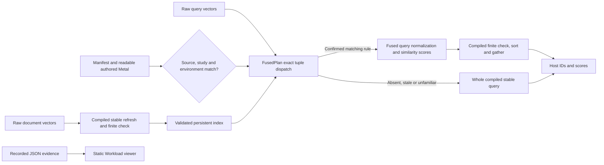

# Workload interface

`lab/workload.html` is the task-centered v0.3 entry point. It retains the charcoal, warm orange signal, branching K and self-hosted IBM Plex fonts of the v0.2 laboratory. The original CPU records and workbench modules remain preserved, with a navigation link to Workload. No framework, remote font, model download or runtime computation service is introduced.

The reading order is installation, a real local cosine-search consumer, then source, dispatch and evidence inspection. The browser presents instructions, examples and recorded JSON. It does not compile or run Metal. The included corpus uses deterministic token-count hashing; no pretrained semantic-model claim is made.

The current CLI uses a compatible confirmed score artifact when present and otherwise the complete compiled stable MLX query. The page's Python example creates `FusedPlan()` and calls `plan.index(vectors)`. The original `Normalizer` plus `CosineIndex` API remains available for row-normalization investigations. NPZ input keys are `documents` and `queries`, sharing float32 or float16 dtype.

The guard selector is explicitly illustrative, not a live device check. It describes exact `[query_count, document_count, width]` tuple eligibility, unfamiliar inputs, candidate dtypes, source/runtime/device mismatches, actual-stride indexing and inference-only scope. Eligibility alone does not establish performance. The source disclosure shows an authored `score_simd.metal` excerpt and names the two scoring sources, `score_simd.metal` and `score_tile4.metal`. It explicitly states that no plan passed the performance gates. The excerpt is never represented as a browser compilation or benchmark result.

## Editable architecture

The separate row-normalization interface follows `CosineIndex → Normalizer → authored row kernel or compiled normalization → compiled ranking`. The two operations have separate manifests and evidence requirements. The second operation reuses normalized document state; it does not silently treat raw documents as normalized.

## Evidence contract

The page fetches `lab/data/workload.json` without caching. Required fields are strings `status`, `headline` and `summary`. Optional fields are `device`, `operation`, `version`, `normalization: {speedup, ci}`, `application: {speedup, ci}`, `methods: [{name, cost_ms, observed_cost_ms, status}]`, `limits: [string]`, `evidence_url` and `artifact_url`. Ratios must be finite positive numbers; intervals contain two finite positive values in increasing order. Costs must be finite and nonnegative. Values enter the DOM as text; links permit HTTP/HTTPS only.

Only **`status: "confirmed"`** permits supplied ratios, `methods[].cost_ms` and an artifact link. `artifact_url` is a download, not a browser execution endpoint, and must appear only for an independently confirmed export. Current source has no such export. A browser status label is not verification; the actual export process must independently pass its gates.

**`status: "measured_null"`** displays both gain metrics as **Not confirmed**, with the failed frozen three-session criterion stated below them. Injected ratios, intervals, `cost_ms` and artifact URLs remain suppressed. A separate `methods[].observed_cost_ms` field may display descriptive measured costs. The caption states that these are means per complete four-task sequence across 120 samples and do not establish a speedup; independent-session intervals remain in [the results](workload-results.md). The current table describes target one, even though the page also presents the second scoring target. Its costs cannot be read as fused-score performance evidence.

All other statuses, including `pending`, ignore both cost fields, ratios and artifact links. Missing costs remain pending. Browser regression source includes a dedicated measured-null injection case that supplies favorable fake ratios, a fake artifact and conflicting cost fields; only the explicit observed cost may appear. Test source is not a claim that the final browser suite has executed successfully.

The original seven-test fused report and 15-check installed consumer retain the [historical `d733761…` measurement pin](../evidence/workload-2026-10-29/target2-fused-scores/fused-study-source-rejected.json). The [current seven-test report](../evidence/workload-2026-10-29/discovery/metal-validation-fused-current.json) re-executed the final adapter and new `628cfe4…` study binding successfully. Its kernel/adapter identity remains `e10fbfb…`. The corrected prospective selector measures actual routed application costs and empty-plan overhead; it has no new performance study. Rejected source and raw pairs remain preserved.

An unavailable or malformed JSON file presents an explicit retry state while leaving local instructions usable. No fabricated timing curve, favorable placeholder or browser GPU claim is supplied. A denied clipboard operation selects the source and explains the system-copy fallback.

The run section also fetches `data/workload-demo.json`, a recording made by `scripts/record_workload_demo.py` from an independent installed CLI. Two changed queries show actual different matches and an explicit library fallback. The page states that the browser does not execute GPU code and omits single-call times from the display. The raw recording retains those times with their cold-call limitation.

The wheel command expects a downloaded pinned `kerneldarwin-0.3.0-py3-none-any.whl` in the working directory. Publication and download verification are separate delivery gates. A release link is not proof that this asset has already been published.

## Review and handoff

The implementation includes native controls, live status regions, keyboard focus, a skip link, reduced-motion handling and layouts down to 320 CSS pixels. Code panels scroll internally. Source implementation alone is not completed visual QA or accessibility conformance. The root task owns final current-source desktop/narrow inspection, browser checks, screenshots and recording after performance workers finish.

Before publication, reconcile the page with the completed CLI and frozen evidence: the first target failed application confirmation, the second target failed its prospective baseline gate, both have numerical GPU evidence, and neither has an accepted artifact. Keep pending timing, missing/malformed JSON, clipboard denial and stale-artifact states honest. Final package contents, quickstart, public links and current-source renders must be checked independently of a green source test.
