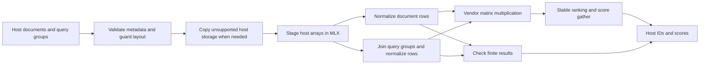

# Compiled batch refresh and search

`search_batches` accepts a document matrix and one to sixteen query matrices. It normalizes the document index once, joins the query rows, executes their similarity and ranking graph, checks finite results and returns the original query-batch boundaries as host lists. It uses optimized MLX libraries. No accepted custom transaction artifact exists.

```python
from kerneldarwin.search import text_vectors
from kerneldarwin.transaction_search import search_batches

texts = ["Metal numerical validation", "Cosine vector search", "MLX query batching",
         "Library fallback", "Memory allocation", "Frozen performance study"]
documents = text_vectors(texts, 384)
queries = [text_vectors(["Metal validation"], 384),
           text_vectors(["vector search", "query batching"], 384)]
results = search_batches(documents, queries, k=3)
# Each result is (document_row_ids, cosine_scores), as nested Python lists.
```

The call is stateless and supports inference only. It preserves inputs, recomputes changed contents, and caches compiled functions rather than answers. Every input must be a two-dimensional MLX float16, bfloat16 or float32 array with a common feature width. Documents must be nonempty. `k` must be an integer from one through the document count. Empty query groups return empty results; an all-empty request still refreshes and validates the document index. Nonfinite document or query values raise an explicit error. There is no persistent index to mutate or roll back.

Mixed query dtypes retain the sequential compiled library path, preserving each query's normalization precision. Other batches use one compiled transaction. Actual MLX strides, offsets and broadcasts are supported. Batch size changes can select a different vendor matrix-multiplication implementation, so application equivalence uses the declared score tolerances and document-ID association, rather than promising bitwise equality to separate queries. Authored rank trials separately require exact IDs and selected score bits relative to the same batched stable library computation.

The guarded suite passed two CPU contract methods and ten actual Metal methods with native API/GPU validation, including a fresh source-free installed wheel. It covers changed documents/queries, mixed and lower-precision inputs, empty groups, invalid inputs, noncontiguous views, ties and adversarial magnitudes. Lower-precision cases are smoke checks. All six actual runtime imports were inside the fresh environment; its validation root had no source tree or development corpus. A separate installed consumer passed eight changed-input top-match checks. The [retained prerequisite evidence](../evidence/workload-2026-11-01/transaction-prerequisites/) binds the actual executed source version; this is not an accepted custom artifact.

An earlier instrumented library-only prototype reduced sorting-path command-buffer submissions from thirteen to four per three-task sequence; reduction paths used seven. Its observed timing intervals favored batching. Those measurements include observer overhead and are a development diagnostic, not accepted custom-kernel performance or a versioned optimized release. Any future authored comparison must use equally composed optimized-library baselines, new untouched confirmation data and a separately frozen protocol. The completed V2 study remains an immutable null result.

Run the [changed-input example](../examples/transaction_search.py) after installing the package. It reverses document contents and verifies eight top matches across two calls, without a corpus file, tuning cache or research UI. Its dispatch is explicitly library-only.

## Host inputs and static batch plans

`TransactionPlan.search` accepts NumPy float16/float32 matrices as well as the MLX inputs above. It includes input validation and host staging in the call. A negative-stride, read-only or unaligned NumPy input is explicitly copied before staging and uses the library fallback. Other unknown valid shapes, layouts, dtypes and direct MLX requests also use the library. Invalid dimensions, unsupported precision or nonfinite data raise an error. Inputs must not be modified concurrently with a call.

```python
import numpy as np
from kerneldarwin.transaction_plan import TransactionPlan

docs = np.random.default_rng(7).normal(size=(37, 97)).astype(np.float32)
groups = [docs[[0]].copy(), docs[[1, 2]].copy()]
plan = TransactionPlan()  # Library default; no accepted batch artifact exists.
results = plan.search(docs, groups, k=5)
```

For the command line, save `documents` and either a 2D/3D `queries` array or consecutive `queries_0`, `queries_1`, … arrays in an NPZ file, then run `kd workload batch vectors.npz --k 5`. Numeric entries are bounded to 256 MiB before allocation; pickle objects are rejected. `--artifact path` loads a data-only plan or reports why it fell back. The result contains actual IDs/scores, the dispatch decision and counts. A single invocation is not a performance claim.

The [host-input example](../examples/transaction_plan.py) and CLI passed sixteen combined changed-input top-match checks from a fresh source-free installation. The expanded suite passed all 28 methods, including 14 actual Metal methods with API/GPU validation, against exact installed source and runtime hashes. The first native run exposed a negative-stride conversion bug; the [regression evidence](../evidence/workload-2026-11-02/transaction-v1/regression/) preserves that failure and the correction. These [new numerical prerequisites](../evidence/workload-2026-11-02/transaction-v1/) do not establish performance. The [prospective batch study](workload-transaction-study.md) compares custom rules against four equally batched optimized libraries, independently of any batching benefit over separate queries.

## Copies and executed graph

A separate [installed call-accounting diagnostic](../evidence/workload-2026-11-02/batch-call-accounting/) observed 27–29 compute dispatches per library request across the three declared profiles. Three generic copy dispatches matched the query-group dimensions. The stride-2 profile's four host constructors copy 1,062,908 bytes of storage span for 568,320 bytes of logical input. Negative-stride fallback adds an explicit dense host copy. Cached Metal buffers were reused, so zero new-buffer API calls does not mean zero copying or logical allocation. Command-buffer counts include the diagnostic's final synchronization; physical bus traffic and exact API-only submission counts remain unmeasured.

The current library path is stateless:



The static dispatcher can select an installed confirmed rule before this graph's rank operation, but no batch rule has passed performance confirmation. The diagram describes the executed library default. The new accounting records do not change that acceptance state.
